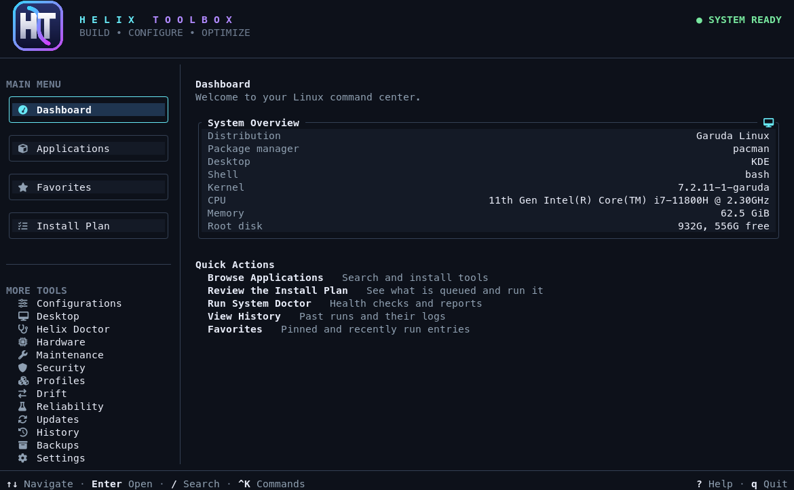
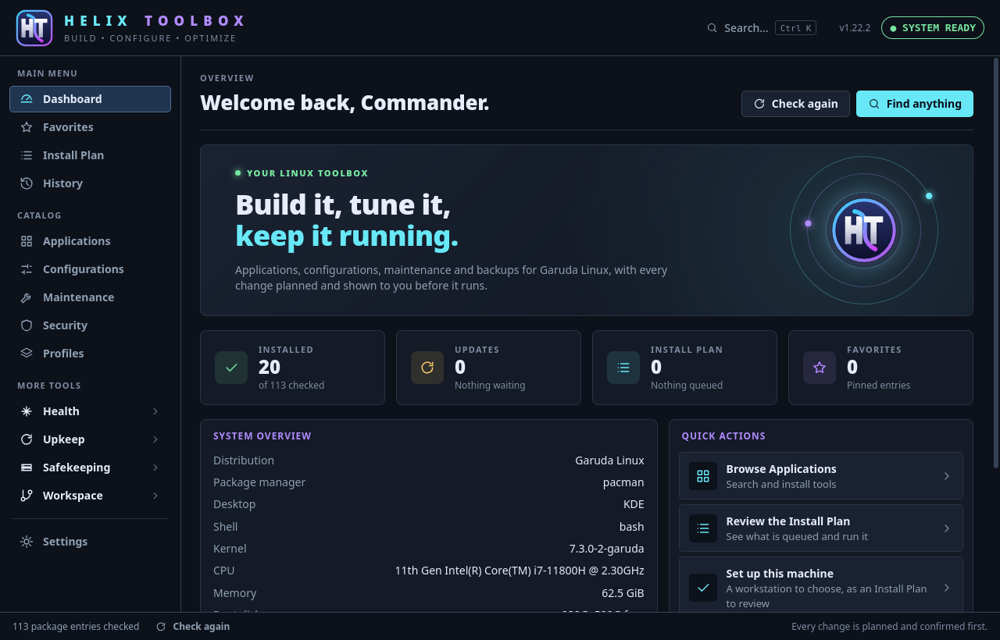
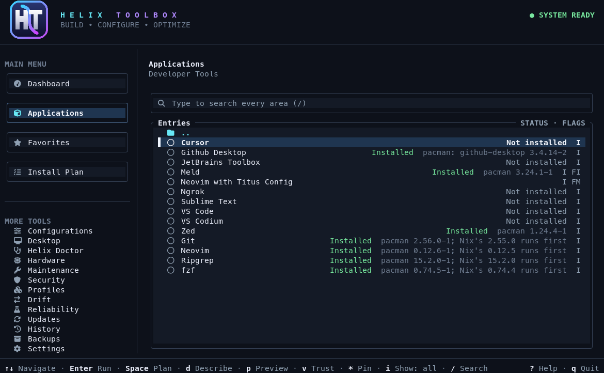
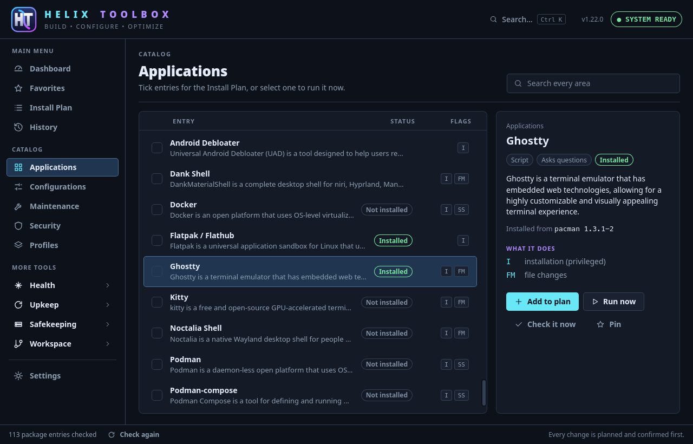
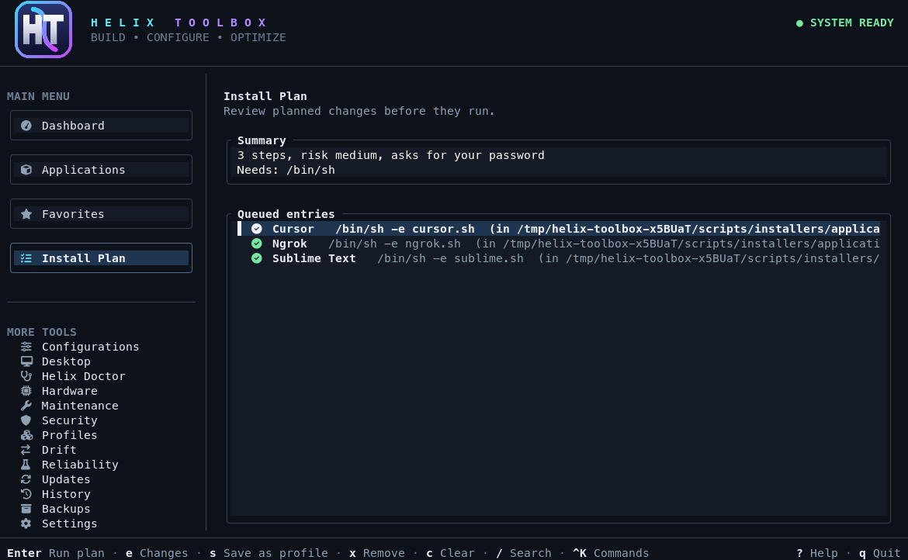
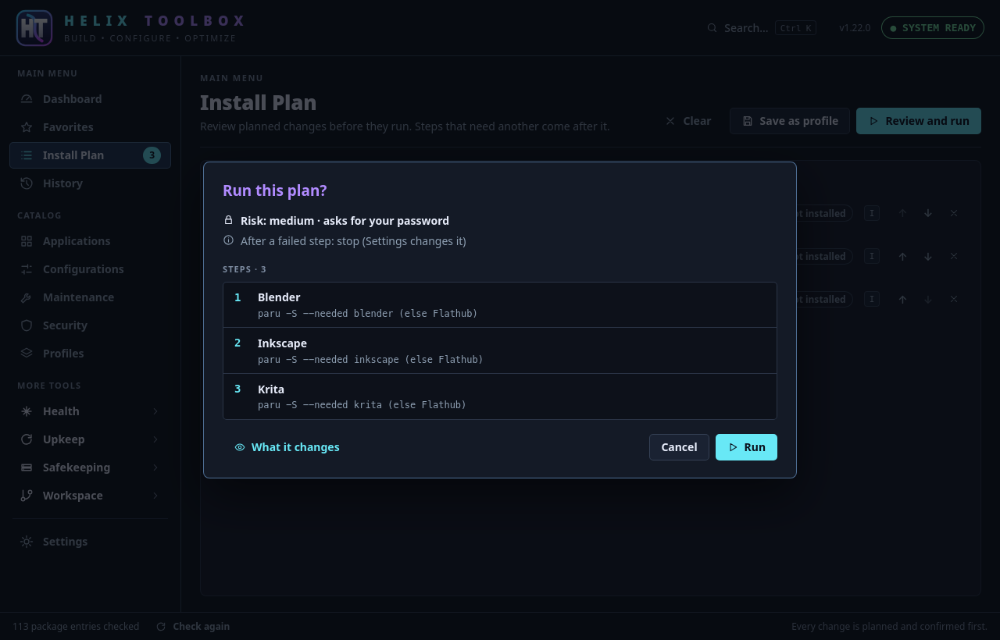
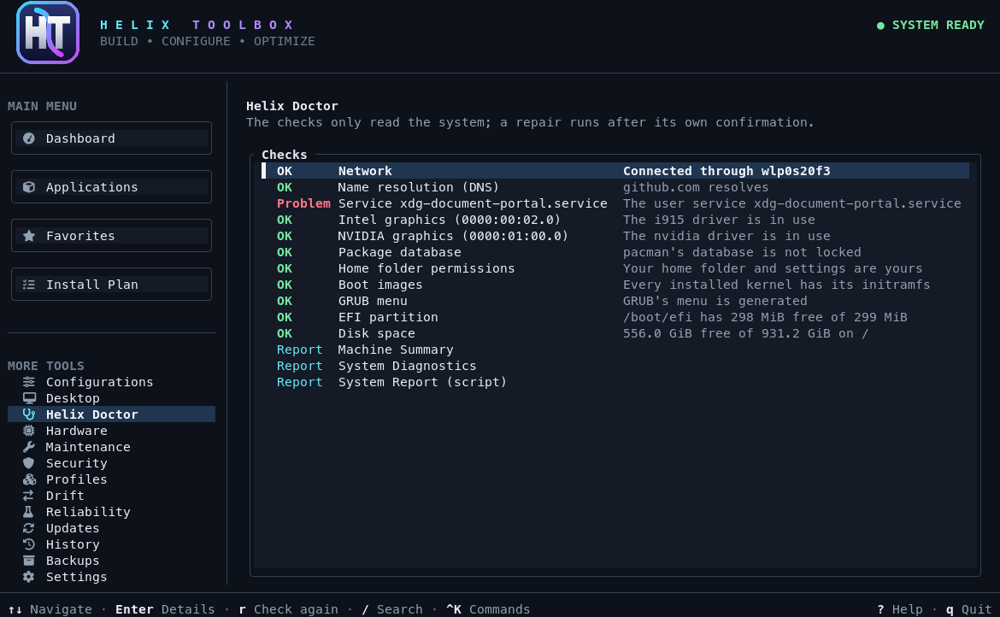
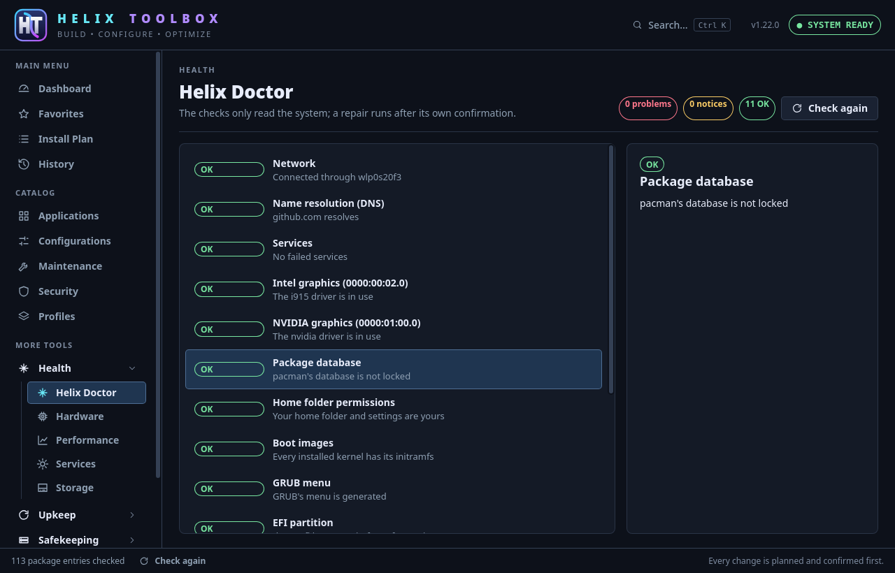
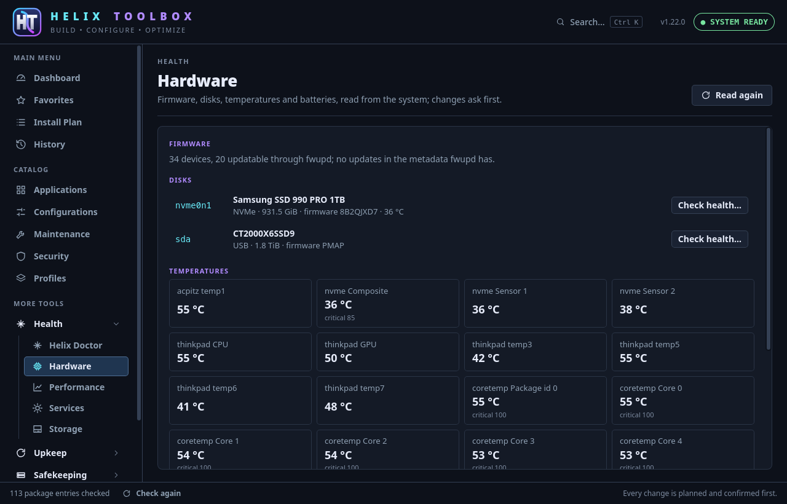

Setting up a Linux machine means a long list of small jobs: install the applications you use, add the right repositories, set up your shell, turn on backups, check that nothing is broken. A few weeks later the machine needs updates from three different package tools, and you can't remember what you changed.

Helix Toolbox puts those jobs in one place. It works whether this is your first Linux machine or your fiftieth, and it never changes anything until it has shown you what it's about to do.

## What it is, in plain words

Helix Toolbox is a free, open source program for setting up and looking after a Linux machine. It covers applications, dotfiles and shell configuration, system tweaks, updates, backups and health checks.

You pick what you want from a catalog of nearly 300 entries. It works out the steps, shows them to you with their risk, runs them once you confirm, checks that they worked and keeps a record.

It's written in Rust, it's MIT licensed, and it works the same way on Arch, Debian, Ubuntu, Fedora and openSUSE. Distributions built on those use the same package managers. Every change is tested in containers of each of them, with real package installs and removals.

If you're new to Linux, the important part is that you don't need to know the commands first. If you've been at this for years, the appeal is different: one view of every package tool on the machine, and plans you can read before they run.

## Terminal or desktop

There are two ways to use it, and both are the same program underneath.

- **The terminal interface** runs with `helix-toolbox`, or `htb` for short. You can use it over SSH, and it works with the keyboard or the mouse.
- **The desktop window** runs with `helix-toolbox-gui` and opens from your application menu like any other program.




*The dashboard in the terminal and in the desktop window.*

The window shows the same catalog, keeps the same Install Plan, and makes the same checks before a run, with the same confirmation, verification and history. The run itself happens in a terminal embedded in the window, so you still see every line of output. Every change to the machine goes through the same engine, whichever one you started from.




*The Applications screen in each. The window shows the selected entry's details beside the list.*

So the choice comes down to where you like to work. If you're a beginner, start with the window. If you live in a terminal or manage a machine over SSH, use the terminal interface. You don't have to settle on one, since they share your settings and history.

## How a run works

Every change follows the same five steps. This is the heart of Helix Toolbox.

1. **Choose.** Queue what you want. In the terminal, `Space` adds the entry you're on. In the window, tick it.
2. **Plan.** The Install Plan lists the steps in order, what each one needs, its risk, and whether it will ask for your password. It checks for conflicts, missing repositories, the wrong hardware and too little disk space before anything runs.
3. **Confirm.** Nothing happens until you say so.
4. **Verify.** Installs and removals are checked against the package manager afterward. If a source fails, it falls back to the next one: the AUR, then Flathub.
5. **Record.** Every run, its output and its result are kept in History, so you can read later what happened.



*The Install Plan, before anything runs.*



*The window asks the same question: here is the risk, here are the steps, and here is what each one changes.*

Want to look closer? In the terminal interface, `p` shows exactly what an entry runs, and `e` shows what a plan will change on this machine, with configuration files side by side as the installer would write them. It also marks what can't be known in advance.

Run it as your normal user. Entries that need root ask for your password when they run.

## What it can do

The list is long, so here are the parts most people reach for first.

### Applications and profiles

The catalog covers applications, development tools, gaming, desktop and shell configuration, maintenance and security, in searchable groups. Each entry shows whether it's installed, where it came from (pacman, apt, dnf, zypper, the AUR or Flatpak), which version you have, and whether an update is waiting.

On the first start, a setup wizard looks at the machine and turns a choice of Developer, Gaming, Privacy or Minimal into an Install Plan for you to review. Press `Ctrl-K` at any time to reach any screen, action or entry by name.

### Updates in one place

The Updates screen gathers what every package tool on the machine has waiting, and hands the work to those tools. You don't have to remember whether something came from your distribution, Flatpak or the AUR.

### Helix Doctor

Helix Doctor checks the network, services, graphics drivers, package databases, permissions, boot images, GRUB, the EFI partition and disk space. Where it finds a problem it offers a repair, and each repair runs only after its own confirmation.




*Helix Doctor in the terminal and in the window.*

### Snapshots and backups

A Snapper or Timeshift snapshot is taken before system changes, and configuration backups can be restored from one screen. For your own files there are Restic backups, with a file's history across snapshots, restores into a new folder that overwrite nothing, backups on a timer, and recovery tests that restore a file and compare its SHA-256. A backup you've tested is one you can trust.

### Drift and moving between machines

HELIX Drift saves how a machine is set up and shows what has moved since, or what a fresh installation still lacks, with the entries that put it back queued for review. Migration goes further: it writes what this machine has to a file that another machine or distribution can read. Catalog entries become that distribution's packages, Flatpaks come from Flathub, and any packages that don't translate are listed for you.

### Hardware and firmware

The Hardware screen covers firmware updates through fwupd, disk, temperature and battery health, and PCI and USB devices. SMART checks and firmware updates sit behind their own confirmation.



*The Hardware page in the desktop window.*

### For power users

- **Services and storage:** systemd services and timers, the applications started at login, and where your disk space goes, with what each cleanup would free.
- **Repositories:** the Git repositories under your project folders, with changes, branches and stashes, committed and synced through reviewed plans.
- **Home Manager:** generations, the files it links, and build, switch and going back to a generation as reviewed plans.
- **Performance and recovery:** how long the boot took and where the time went, and whether the machine could be brought back.
- **Reliability and trust:** how far each entry has been tested, where an installer comes from, and what it downloads unchecked.
- **Offline bundles:** packages, installed Flatpaks and Helix Toolbox in one checked folder, for a machine without reliable internet.

Everything is also a command, with `--dry-run` and stable `--json` output, so it works in your own scripts:

```sh
helix-toolbox search editor             # find entries
helix-toolbox status                    # what is installed, updated or managed
helix-toolbox run git ripgrep --dry-run # the plan, nothing changed
helix-toolbox updates --online          # what every package tool has waiting
helix-toolbox doctor                    # the health checks
```

## Install it

You need Linux on x86_64 or aarch64 (ARM64) with glibc 2.35 or newer.

### Try it without installing

This runs the latest release straight from GitHub. Run it as your normal user, not with `sudo`:

```sh
curl -fsSL https://raw.githubusercontent.com/Commanderx-code/Helix-toolbox/main/start.sh | sh
```

The script downloads the release for your machine into a temporary folder, checks it against its published SHA-256 sum, runs it, and removes the folder when you quit. If you'd like to read a script before you pipe it into a shell, and that's a good habit, [`start.sh`](https://github.com/Commanderx-code/Helix-toolbox/blob/main/start.sh) is short.

This only tries the terminal interface. Anything you confirm inside it still happens for real.

### Install the terminal version

Download the package for your distribution from the [latest release](https://github.com/Commanderx-code/Helix-toolbox/releases/latest), then run the matching command from the folder it's in.

Arch, Garuda, CachyOS, EndeavourOS and Manjaro:

```sh
sudo pacman -U helix-toolbox-*-x86_64.pkg.tar.zst
```

Debian, Ubuntu, Mint and Pop!_OS:

```sh
sudo apt install ./helix-toolbox_*_amd64.deb
```

Fedora:

```sh
sudo dnf install ./helix-toolbox-*.x86_64.rpm
```

openSUSE:

```sh
sudo zypper install --allow-unsigned-rpm ./helix-toolbox-*.x86_64.rpm
```

Any distribution, if you have Rust:

```sh
cargo install --locked helix-toolbox
```

On Arch there's also a [package repository](https://docs.helixtech.app/toolbox/install/#the-arch-repository) that keeps it updated with the rest of the system. ARM64 packages are on the same release page, and the [install guide](https://docs.helixtech.app/toolbox/install/) has their commands.

### Add the desktop window

Install the terminal version above first, because the window relies on it. Then install the window's package from the same release, named `helix-toolbox-gui`. It comes as an Arch package, a `.deb`, an `.rpm` or an AppImage:

```sh
sudo pacman -U helix-toolbox-gui-*-x86_64.pkg.tar.zst   # Arch and derivatives
sudo apt install ./helix-toolbox-gui_*_amd64.deb        # Debian, Ubuntu
sudo dnf install ./helix-toolbox-gui-*.x86_64.rpm       # Fedora
```

The packages add a Helix Toolbox entry to your application menu.

### Check your download

Every release file has a SHA-256 sum and a signed build provenance attestation:

```sh
sha256sum --check --ignore-missing SHA256SUMS
gh attestation verify <file> --repo Commanderx-code/Helix-toolbox
```

After that, you won't need to download anything by hand. The Updates screen's Helix Toolbox row fetches, checks and installs each new release, the same way your copy was installed.

## Your first ten minutes

If this is your first time, here's a safe way to find your feet. Nothing below changes your machine until you confirm a plan.

1. Start it as your normal user, and let the setup wizard look at the machine.
2. Pick the choice closest to you and read the plan it builds. You can back out here.
3. Open Helix Doctor and see how the machine is doing.
4. Search for something you use. Press `/` in the terminal, or use the search field in the window.
5. Queue one small application and read its plan from top to bottom before you run it.
6. Open History afterward and see what was recorded.

A few keys cover most of the terminal interface:

| Key | Does |
| --- | --- |
| `Tab`, `j`, `k` | Move between screens, or within a list |
| `Enter` | Open a group, run an entry, or run the Install Plan |
| `Space` | Add the entry to the Install Plan |
| `/` | Search every area |
| `d` | Describe the entry |
| `p` | Show exactly what the entry runs |
| `u` | Update the entry |
| `Ctrl-K` | Find any screen, action or entry by name |
| `?` | Show every key |

## Where to go next

The [user guide](https://docs.helixtech.app/toolbox/guide/) walks through the screens and the common jobs step by step, and [the window's guide](https://docs.helixtech.app/toolbox/gui/) covers the desktop version. If you want to know how it runs things safely, read the [security notes](https://docs.helixtech.app/toolbox/security/).

Found a bug or have an idea? The [issue forms](https://github.com/Commanderx-code/Helix-toolbox/issues/new/choose) are open. The general catalog started as [Linutil](https://github.com/ChrisTitusTech/linutil)'s, which is also MIT licensed, so thanks to that project too.
